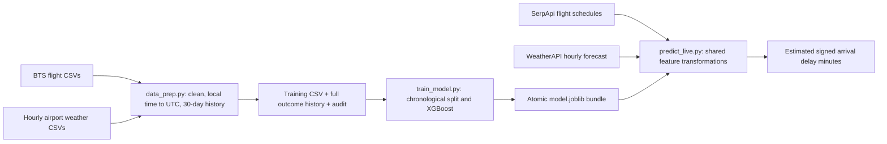

# AeroPredict: arrival delay minutes

AeroPredict now has two phases: offline training on individual historical flights and airport weather, and live inference from SerpApi Google Flights schedules plus WeatherAPI forecasts. It estimates **signed arrival delay minutes**: positive means late and negative means early. An exact-looking number is a model estimate, not a guarantee or an airline-confirmed delay.

The former monthly risk classifier, probability blending, AeroDataBox/OpenSky/FAA adapters, login/dashboard routes, and associated UI have been removed from the active codebase. Original datasets and local databases have been preserved; the new pipeline does not use the old model artifacts. Existing `.env` files were not changed. You supply the historical CSVs and provider keys.



## 1. Install in a clean environment

Run from the repository root. Python 3.13 was used for verification. The application does not need a GPU. `requirements.txt` declares runtime ranges, `requirements-dev.txt` adds tests, and `requirements.lock.txt` records the exact tested versions plus Linux's Gunicorn server. Reuse the same versions for training and serving saved artifacts.

Windows PowerShell:

```powershell
py -3.13 -m venv .venv
.\.venv\Scripts\python.exe -m pip install --upgrade pip
.\.venv\Scripts\python.exe -m pip install -r requirements.lock.txt
.\.venv\Scripts\Activate.ps1
```

If activation is restricted by your machine's policy, use `.\.venv\Scripts\python.exe` in place of `python` in every command below. Changing the machine execution policy is unnecessary.

macOS/Linux:

```bash
python3.13 -m venv .venv
source .venv/bin/activate
python -m pip install --upgrade pip
python -m pip install -r requirements.lock.txt
```

The required libraries include pandas/NumPy for preparation, scikit-learn for preprocessing/metrics, XGBoost for regression, joblib for artifacts, airportsdata/tzdata for airport identifiers and IANA time zones, requests for provider calls, and Flask for the optional server. Meteostat is not required at runtime because the pipeline reads your downloaded CSVs.

## 2. Supply historical archives

Place flight CSVs in `data/raw/bts/` and weather CSVs in `data/weather/`. Quoted glob patterns work on Windows and Unix. Some files already in `data/raw/` are **Git LFS pointers**, not downloaded data; the loader detects these and explains the problem.

### Flight columns

These BTS names and their usual mixed-case variants are accepted:

| Column | Purpose |
| --- | --- |
| `FL_DATE` / `FlightDate` | Departure calendar date |
| `OP_UNIQUE_CARRIER` / `Reporting_Airline` | Carrier code; required when flight numbers are numeric |
| `OP_CARRIER_FL_NUM` / `FL_NUM` | Flight number |
| `ORIGIN`, `DEST` | Airport IATA codes |
| `CRS_DEP_TIME` / `CRSDepTime` | Origin-local scheduled HHMM time |
| `ARR_DELAY` / `ArrDelay` | Signed actual gate-arrival delay, the regression target |
| `CANCELLED`, `DIVERTED` | Exclude operations without a comparable arrival-delay target |
| `DEP_DELAY` + `ACTUAL_ELAPSED_TIME` | Derive when the actual arrival became observable |

For outcome timing, `actual_arrival_utc` or `outcome_available_utc` can replace the last pair. `CRS_ELAPSED_TIME + ARR_DELAY` is also supported. A complete UTC form is accepted directly:

```csv
carrier,flight_number,origin,destination,scheduled_dep_utc,actual_arrival_utc,arr_delay_min
AA,123,JFK,LAX,2025-01-01T14:40:00Z,2025-01-01T21:00:00Z,20
```

These example rows describe a schema, not real observations. Bare flight number `123` is not a unique key: history uses **carrier + flight number + origin + destination**. That allows newer airlines such as Breeze (`MX`) to be searched without requiring them to exist in the old training dataset. Coverage in BTS and Google Flights can still be incomplete.

If a minimal archive has only the fields in the original example, the completion time is unknowable. The pipeline fails with a useful message unless you explicitly supply `--assumed-outcome-lag-hours 48`. This records a conservative **assumption**, not verified timing. Prefer actual completion timestamps. Add `--outcome-reporting-lag-hours` when outcomes become available later than arrival; BTS publication itself can be much later than the flight.

BTS clock values are local times, not UTC. Airport time zones are resolved from reference data, including Hawaii and Alaska. `2400` rolls into the next day. DST folds/gaps are rejected unless your data provides explicit UTC timing. Invalid rows fail by default; `--drop-invalid` opts into counted exclusions. See the [BTS reporting fields](https://transtats.bts.gov/Fields.asp?gnoyr_VQ=FGJ) and [BTS reporting guidance](https://www.bts.gov/topics/airlines-and-airports/number-26-technical-directive-time-reporting-effective-jan-1-2017).

### Weather columns and units

The default canonical format uses explicit units:

```csv
timestamp_utc,airport_icao,temperature_f,wind_speed_mph,visibility_miles,precipitation_inches
2025-01-01T15:00:00Z,KJFK,38,12,10,0
```

Every hourly record must identify its airport and UTC hour. Meteostat station IDs are not airport ICAO codes: add an `airport_icao` column when exporting each station. Naive values in a documented UTC timestamp column are treated as UTC; export actual UTC rather than local station clocks.

For Meteostat columns `time,airport_icao,temp,wspd,prcp`, use `--weather-units meteostat`. Celsius becomes Fahrenheit, km/h becomes mph, and millimeters become inches. Visibility is often absent and stays missing rather than being invented. The model imputes missing measurements using training-only statistics and includes missingness indicators. See [Meteostat units](https://dev.meteostat.net/formats.html).

Generic columns `Timestamp,Airport ICAO,Temperature,Wind Speed,Visibility,Precipitation` require `--weather-units imperial` or `metric`; metric means Celsius, km/h, kilometers, and millimeters. Explicit suffixes such as `wind_speed_ms` or `visibility_meters` take precedence. Raw NOAA packed fields, quality flags, subhourly station records, and sentinel values require normalization to this hourly schema; the pipeline does not silently guess their meaning.

## 3. Prepare the training matrix

```bash
python data_prep.py --flights "data/raw/bts/*.csv" --weather "data/weather/*.csv" --weather-units meteostat --horizon-hours 24 --output data/training/flights.csv
```

Use `--weather-units canonical` for the explicit-unit weather example above. The example command trains features for a prediction made 24 hours before scheduled departure; use another consistent horizon if needed.

The job normalizes and deduplicates flight occurrences, excludes canceled/diverted/missing-target rows, converts schedules to UTC, and rounds schedules to the nearest UTC hour with half-hour values rounded up. It performs the requested **inner join on origin ICAO and rounded UTC hour** with a many-to-one constraint. Conflicting duplicate airport/hour records fail instead of multiplying flights.

History uses scheduled departures within the preceding 30 days, and only outcomes strictly known before the prediction cutoff. It calculates history before joining weather, so a missing weather record cannot erase a valid outcome. A flight without specific history gets the available global 30-day mean; only a complete lack of past history gives zero. Departure hour/month/weekday use the origin's local clock so rush-hour features make sense.

Outputs:

- `flights.csv`: feature matrix, signed target, and time/identity metadata.
- `flights.history.csv`: normalized historical outcomes, including flights without weather matches.
- `flights.audit.json`: row counts, exclusions, match rate, unit/time assumptions, input paths, and schema.

The feature columns are `carrier`, `flight_number`, `origin`, `destination`, `dep_hour`, `dep_month`, `dep_day_of_week`, `hist_flight_num_delay_avg`, `temperature_f`, `wind_speed_mph`, `visibility_miles`, and `precipitation_inches`. The target is `arr_delay_min`.

The pandas implementation loads the chosen archives into memory and uses a sorted sweep for historical averages. It is not an out-of-core data warehouse. One or two nationwide years can require substantial RAM; begin with selected airports/months and retain sufficient prior history. Monitor the audit's weather match rate because an inner join can create selection bias.

## 4. Train and evaluate XGBoost

```bash
python train_model.py --input data/training/flights.csv --output artifacts/candidate --n-jobs 2
```

The split is chronological, approximately 80/20, with equal prediction timestamps kept together. Training outcomes still unknown at the first test prediction are purged. The encoder/imputer fit only on training rows; tree models need no scaler. XGBoost uses CPU histogram trees, regularization, row/column sampling, and bounded categorical encoding. Targets remain signed and are not clipped at zero.

The trainer recomputes historical features from the history sidecar rather than trusting precomputed CSV values. Test history is **frozen at the first test prediction**, so subsequent test labels cannot leak into the model or its historical baseline. This is intentionally conservative; very late holdout flights may no longer have history within 30 days.

Outputs in the chosen directory:

| Artifact | Contents |
| --- | --- |
| `model.joblib` | Atomic, self-contained pipeline, 30-day history tail, exact feature contract, training cutoff, horizon, run ID, and evaluation metadata |
| `metrics.json` | MAE/RMSE in minutes, historical-mean and zero-delay baselines, split dates/counts, purge counts, and evaluation provenance |
| `history_lookup.csv` | Timestamped history tail, allowing the 30-day mean to expire correctly |
| `feature_importance.csv` | Measured normalized XGBoost gain by encoded feature; no hard-coded chart weights |

The default artifact is the evaluated training-split model. After reviewing results, `--refit-all` trains a new deployment model on all known outcomes while preserving the earlier holdout metrics and explicitly marking that they do not directly evaluate the refitted model:

```bash
python train_model.py --input data/training/flights.csv --output artifacts --refit-all --n-jobs 2
```

Model + preprocessing + history commit together via one atomic file replacement. Companion reports are informational and have run IDs. Runtime never assembles a model from separately updated files. Load only your own trusted joblib artifacts; they use Python pickle semantics.

**Evaluation limitation:** the requested nearest-hour historical merge uses observed weather that may occur after the forecast was issued. Testing against those observations does not measure actual next-day forecast error. This is a retrospective weather-proxy evaluation, not a fully deployment-realistic backtest. Save forecasts with their issue times and evaluate against verified arrivals at the same horizon before claiming production accuracy. Check performance by airline, airport, season and disruption severity; feature gain is not a causal explanation.

## 5. Configure live providers

Only you create the accounts and obtain the keys. The app never buys access or changes subscriptions. Provider terms, allowances and forecast horizons depend on your account; check them before assigning budgets. Both providers default to **zero outgoing attempts**. Existing `.env` is untouched; Python reads process environment and does not automatically load `.env`.

PowerShell prompts avoid embedding keys in command history:

```powershell
$env:SERPAPI_API_KEY = (New-Object System.Net.NetworkCredential('', (Read-Host 'SerpApi key' -AsSecureString))).Password
$env:WEATHERAPI_API_KEY = (New-Object System.Net.NetworkCredential('', (Read-Host 'WeatherAPI key' -AsSecureString))).Password
$env:SERPAPI_DAILY_LIMIT = Read-Host 'Maximum SerpApi attempts per rolling day'
$env:SERPAPI_31DAY_LIMIT = Read-Host 'Maximum SerpApi attempts per rolling 31 days'
$env:WEATHERAPI_DAILY_LIMIT = Read-Host 'Maximum WeatherAPI attempts per rolling day'
$env:WEATHERAPI_31DAY_LIMIT = Read-Host 'Maximum WeatherAPI attempts per rolling 31 days'
$env:WEATHERAPI_FORECAST_DAYS = '3'
```

Keep each budget within the confirmed allowance, accounting for other uses of those keys. Change forecast days only to a horizon your plan supports. See [SerpApi Google Flights](https://serpapi.com/google-flights-api) and [WeatherAPI documentation](https://www.weatherapi.com/docs/).

```bash
python predict_live.py --origin RDU --destination MCO --date 2026-09-06 --model artifacts/model.joblib
```

Replace the date with a current/future departure date within the configured weather window. The search is one-way/nonstop and parses deduplicated legs in `best_flights` and `other_flights`. Google Flights is a schedule/shopping source, not a complete operational flight tracker or a source of verified arrival labels.

Weather is requested near the origin's coordinates and selected by the rounded UTC `time_epoch`, not an ambiguous local hour string. The location is validated against the airport. Current observations are usable only for their own current hour; missing future weather produces an unavailable result. No forecast is fabricated.

The historical feature observes both the model's training horizon and the actual request cutoff. Responses report the trained and actual forecast horizons; accuracy at a different horizon remains unvalidated. Shared feature functions and the saved preprocessing pipeline keep units, time features, category handling and column order consistent.

Successful terminal output follows `Flight AA123 from JFK is predicted to be 38.0 minutes late.` Negative estimates read `minutes early`. These are examples of formatting, not forecasts for an actual flight. `--json` returns structured details; unavailable/empty results exit with code 2.

### Run immediately without APIs or downloads

```bash
python scripts/make_demo_data.py
python data_prep.py --flights var/demo/flights.csv --weather var/demo/weather.csv --horizon-hours 24 --output var/demo/training.csv
python train_model.py --input var/demo/training.csv --output var/demo/artifacts --refit-all --as-of 2025-05-01T13:40:00Z --n-estimators 40 --n-jobs 1
python predict_live.py --model var/demo/artifacts/model.joblib --flights-json var/demo/serpapi.json --weather-json var/demo/weatherapi.json --as-of 2025-05-01T13:40:00Z
```

The demo uses **synthetic data** and spends no requests. Its scores verify integration only; they are not evidence of aviation accuracy. `--as-of` requires both saved flight and weather files, so a past demonstration cannot accidentally fetch today's forecast. Offline weather JSON can be a normal WeatherAPI response or an object keyed by airport IATA/ICAO.

## 6. Optional web interface

```bash
python -m backend.app
```

In a second terminal:

```bash
cd frontend
npm ci
npm run dev
```

Open the Vite URL. The interface shows the two phases, model readiness, a route/date search, signed delay estimates, and historical support. If a server token is required, enter it under **Server access**; it stays in memory. Provider keys never enter the browser. Set `AEROPREDICT_API_TOKEN` before exposing the API beyond your own machine, and keep `ALLOWED_ORIGINS` restricted to your UI. A bearer token is basic access control, not a complete multi-user identity system.

| Endpoint | Behavior |
| --- | --- |
| `GET /health` | Process liveness without model or provider calls |
| `GET /api/model-status` | Whether an artifact file is installed |
| `POST /api/predict-live` | JSON `origin`, `destination`, `date`; validates model/access before searching |

Local Flask binds to `127.0.0.1:5001` without debug mode. Use Gunicorn or the container for deployment. To point a built frontend at another server, set `VITE_API_BASE_URL` before `npm run build`.

## 7. Sustainable deployment and improvement

The full deployment, retry policy, logging, and retraining steps are in [DEPLOYMENT.md](DEPLOYMENT.md). A small CPU service with persistent storage is a practical starting point; training stays an offline job. No cloud resources or paid API calls have been created by this implementation.

New verified archives improve the available training evidence only when you prepare and retrain. SerpApi schedules and the model's own predictions never become target labels. The old self-updating Bayesian layer has been removed. For genuinely current 30-day history, supply recent verified outcomes; historical BTS archives may lag live operations. When history is stale, the response reports zero matching support and uses its documented fallback.

Tests and frontend checks:

```bash
python -m pytest tests -q
cd frontend
npm run lint
npm run build
```

The tests exercise timestamp/DST conversion, unit conversion, outcome availability, history isolation, duplicate handling, chronological holdout leakage, real XGBoost serialization, missing-weather behavior, provider caching/budgets/concurrency, and HTTP access/model checks. Real predictive accuracy requires your real archives. Live provider calls and Docker deployment require separate verification in your environment.
